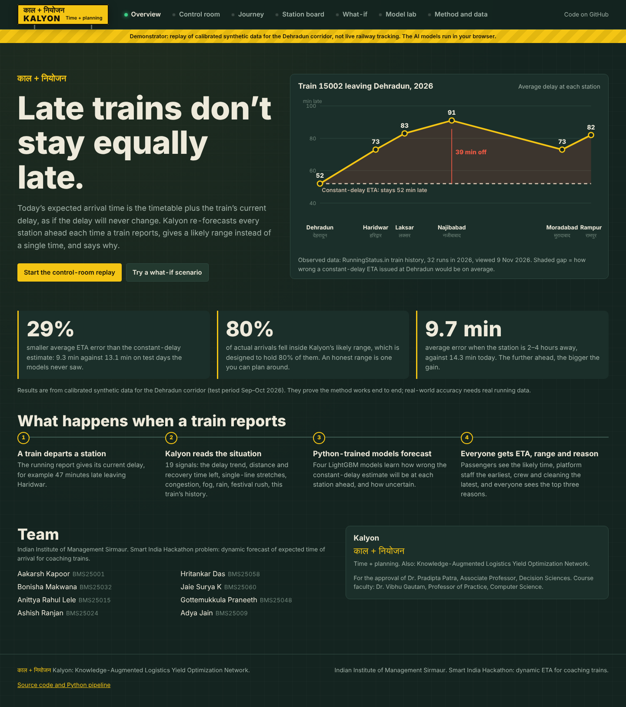
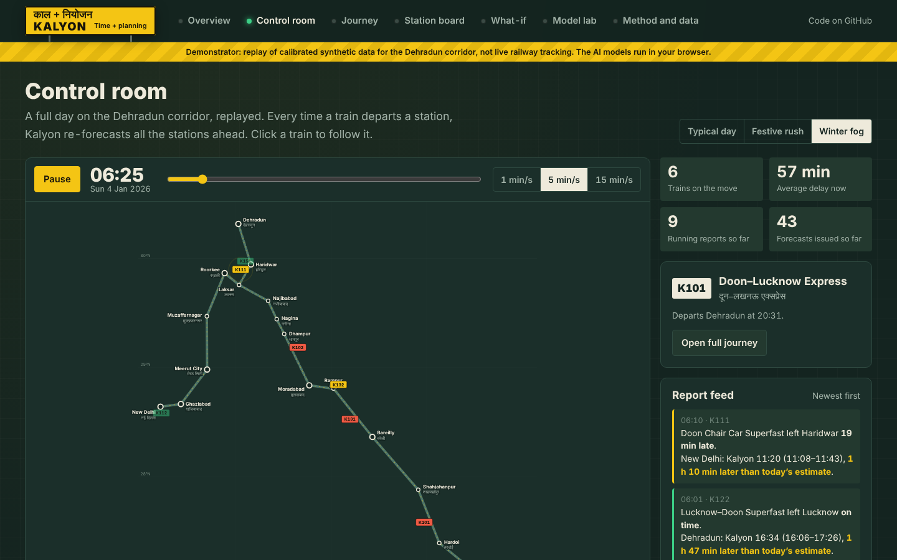
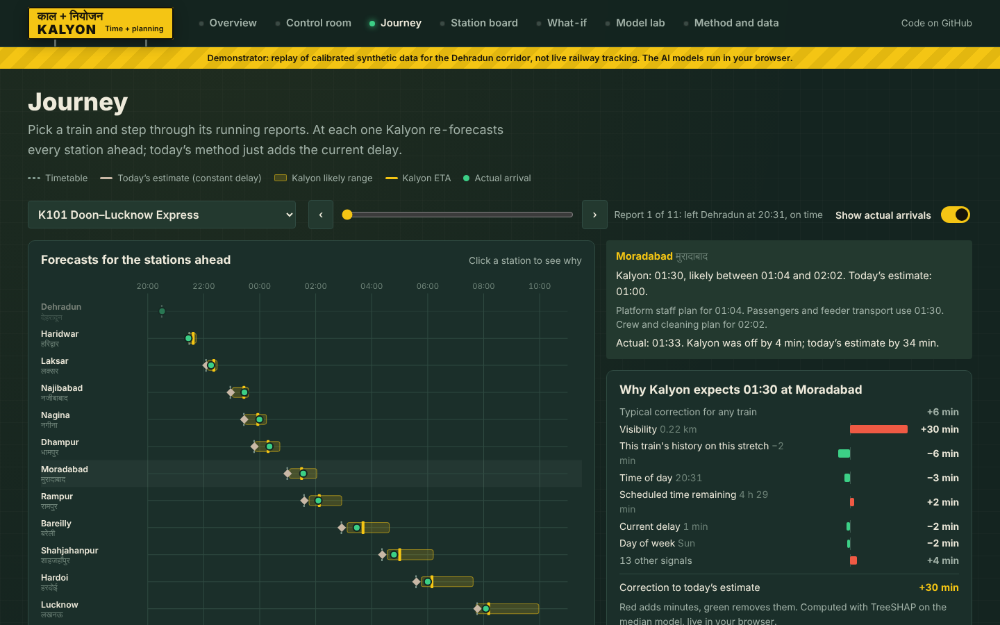

# Kalyon · काल + नियोजन

**Time + planning.** Kalyon (Knowledge-Augmented Logistics Yield Optimization Network) is a dynamic, uncertainty-aware ETA forecaster for Indian Railways coaching trains. It was built for the Smart India Hackathon problem *Dynamic Forecast of Expected Time of Arrival (ETA) for Coaching Trains*.

**Live demo:** https://kapoor9.github.io/Kalyon/

> **Demonstrator.** The website replays **calibrated synthetic data** for the Dehradun corridor of Northern Railway. It is **not live railway tracking**. Results show that the method works end to end; they are not a measure of real-world accuracy.



## The problem

Public ETAs are usually the timetable plus the train's current delay, which assumes that delay never changes. Real data says otherwise. RunningStatus.in shows train 15002's average delay growing from 52 minutes at Dehradun to 91 at Najibabad, then falling to 73 at Moradabad (32 runs in 2026). Many trains also start hours late because they are rescheduled at their origin.

## What Kalyon does

Every time a train departs a station, Kalyon:

1. builds 19 signals: delay trend, distance and recovery time left, single-line share, congestion, fog, rain, festival rush, and this train's history on the stretch ahead;
2. predicts how wrong the constant-delay estimate will be at **every station ahead**, using LightGBM trained in Python;
3. gives a **likely range** (10th–90th percentile, calibrated to hold 80% of arrivals);
4. explains each forecast with its **top reasons** (TreeSHAP), in minutes.

## Results on unseen test days (synthetic, Sep–Oct 2026)

| Method | Average error | Within ±15 min |
| --- | --- | --- |
| B0 Timetable | 38.4 min | 53% |
| B1 Constant delay (today's method) | 13.1 min | 71% |
| B2 Historical average | 43.5 min | 28% |
| **M1 Kalyon point model** | **9.3 min** | **83%** |
| **M2 Kalyon median** | **9.2 min** | **83%** |

- Kalyon's likely range held **79.9%** of actual arrivals (target: 80%).
- Beyond the next station, error falls from 14.8 to 10.5 minutes (Wilcoxon signed-rank test, p < 0.001, 20,680 paired forecasts).
- The gain grows with distance ahead: 2.3 minutes at the next stop, up to 5.2 minutes further out.
- For two trains held out of training, Kalyon still beats today's method (8.8 against 9.2 min), but by less. This shows the value of history.

Full numbers are in [`reports/metrics.json`](reports/metrics.json).

## The website

The interface is a night-operations console: a real-time 3D home (which is also the loading screen), Apple-style scroll storytelling (pinned, scroll-scrubbed chapters built with GSAP ScrollTrigger), a 3D tactical map of the corridor (three.js with bloom: terrain, Ganga and Yamuna, double and single lines, station beacons, trains with light trails), and a guided first-visit tour.

**The home** (`docs/js/home.js`, `docs/js/home/`) replaces the old row of tabs. Every visit opens here. After loading, a cloud of light condenses into the Kalyon nameboard inside a railway clock whose hands show the replay time, a rail-track ribbon draws itself round it, and the nine sections swing out one by one from a spine of glass rings wrapped in a coil of track, as glass cards tied to it by threads of light, with a living network of drifting nodes behind. The clock then rides the spine above the card in front. Scrolling turns the spiral (the cards fan out and lean while it moves, and close up when it stops, gliding to the nearest card); the card in front can be entered (the camera flies into it). A section can be linked directly with `?view=name`. A "What are you looking for?" list lights up the cards for passengers, station staff, the AI or the team, and a floating Index button, shown only on the spiral, opens every section at once like a folder on a phone. Inside a section, **All sections** in the top bar goes back to the spiral at that section's card, and each console page keeps its **Next** bar to the following step. Without WebGL the cards show as a plain grid.

| Section | What it shows |
| --- | --- |
| Briefing | Scroll story: the problem in real data, origin rescheduling, how a forecast is made, results, the team |
| Meet the team | The two faculty members and the eight students on a night-platform photograph; tap a card for a short profile |
| Passenger | What a traveller would see, in one continuous real-time 3D world: the arrival time in plain words with its likely range, a boarding pass, the road ahead, tips from "Saathi", high alerts with sound, vibration and spoken English or Hindi, and a pick-up planner. Every number is the same Kalyon forecast the station board shows |
| Control room | A full day replayed on a rotatable 3D map; every departure triggers a re-forecast; click a train to see its projected path and ETAs |
| Journey & board | Journey: one train's forecasts at every report, against what happened, with reasons. Station board: a split-flap arrivals board with today's estimate, Kalyon ETA, range, platform-ready time |
| What-if | Change delay, fog, rain, festival, rescheduling and watch the models react live |
| Optimisation Lab | Prescriptive dispatching: from Kalyon's forecasts it finds the conflicts ahead (single-line crossings, headways, station lines, engineering blocks) and computes the plan that minimises priority-weighted delay, with every decision explained |
| Under the hood | One real forecast made step by step by the models running live in the browser: the report, the 19 signals, every decision tree, the range, the reasons (TreeSHAP), and where every figure on the site comes from |
| Model lab & method | Model lab: baselines, error by horizon, interval honesty, hypotheses H1–H4, feature importance. Method and data: the Python pipeline, real observations, calibration, data-quality rules |




Built with plain JavaScript modules, three.js and GSAP (vendored in `docs/vendor`, see [licences](docs/vendor/LICENSES.md)); no build step.

The trained LightGBM trees are exported to JSON and evaluated in the browser by `docs/js/engine.js`, which includes a TreeSHAP implementation. `tests/parity.mjs` checks that predictions, features and SHAP values match Python exactly.

## The passenger view

The Passenger tab is built to feel like a real travel app rather than a dashboard: one continuous three.js world the camera flies through as you scroll, in fourteen chapters (`docs/js/pv/`). No purchased models: the WAP-7 locomotive and LHB coaches are modelled in code.

1. About 40,000 particles sampled from the train's own surfaces condense into it while the station materialises; the headlight flickers on.
2. Scrolling pushes the camera into the headlight, through a white-out, into a tunnel streaming the real timetables of the day's replayed trains.
3. Your boarding platform (its yellow board shows the station you picked); the coach door plugs out and slides open; down the aisle. The coach windows are interior-mapped: each pixel traces a lit chair car behind the glass.
4. A window seat: the night-berth video on the glass, with water drops that slide and refract (heavier on rainy days), and the sway of the coach.
5. The coach's LED dot-matrix display wipes from the station display's estimate to Kalyon's ETA and range.
6. Your boarding pass as a 3D card with holographic foil; it flips, and the stub tears off.
7–8. Out through a window and up over the whole corridor (stations placed from `data/network.json`): your route in gold, the part already run brighter, the train as a comet. Drag the time scrubber and it moves; the sky follows the replay clock.
9. Low over the line past floating bilingual station signs with the road-ahead times; passed stations dim, the next one glows.
10. Saathi: a particle sculpture that morphs (clock, wave, fog, rain, crowd) as the tips go by.
11. The day's weather in 3D: the train approaches through fog the headlight cuts, or rain.
12. The forecast as a river of light: the likely range as a glowing band, with posts for the timetable, today's display and Kalyon.
13. Alerts slam in with a glitch, a camera shake and, for critical ones, a red pulse; a colour-light signal shows the most serious alert in your list.
14. The destination photograph as a depth mesh, a pick-up dial, and a sticker burst.

It runs on one renderer with a frame-time governor that lowers resolution and effects until the frame rate holds; every set's shaders are compiled while the page is idle, so no chapter hitches when it first appears. Reduced-motion users get the finished scenes without the opening or camera shake, and browsers without WebGL get a still photograph with the same content. The photographs (collected by the team, enlarged with the EDSR super-resolution model and given depth with Depth Anything V2, both run offline by `tools/prep_media.py`) are used for the night-berth video and the destination.

The 3D world draws only text and numbers handed to it by `docs/js/passenger.js`; it never computes a time. Alignment with the model is strict: the arrival time is the forecast median, "be on the platform by" is the low end of the range, arrived trains show their actual time, and before the first running report no forecast is shown. These are the same rules as the Station board; `node tests/passenger_match.mjs` checks 144 journey states (three days, six times, eight trains) against the Station board's own rows, including every string the 3D world draws, and finds no difference.

## From prediction to prescription: the optimisation engine

Kalyon also decides **what controllers should do**. Given a moment on the corridor, the engine (`kalyon/optimise.py`, mirrored in `docs/js/optimise.js`):

1. takes Kalyon's median ETA for every station ahead of every train as the expected running times;
2. builds a time model (arrival and departure events) with the rules of the track: no two trains in opposite directions on a single line, a headway between trains in the same direction and overtaking only at stations, a limited number of lines at each station, no early departures, and optional engineering blocks;
3. finds the conflicts the forecast implies and chooses, for each, which train goes first, so that the **priority-weighted sum of arrival delays** is as small as possible. The decisions are crossing order and place, precedence and overtaking, holds and, once times are fixed, platform-line allocation;
4. solves it **exactly** with branch and bound in the browser. The bound is the delay of the partial plan, which can only grow as conflicts are settled;
5. explains every decision by reversing it and re-optimising, reporting what that would cost.

**The AI dispatcher** (`kalyon/dispatch.py`) is a LightGBM classifier trained by imitation learning: 646 snapshots of the training period were solved to proven optimality with HiGHS (an open-source MILP solver, via SciPy). It learned from 2,676 resolved conflicts which train should go first. It orders the branch-and-bound search and is also offered as an instant rule. Reinforcement learning was not used: an exact solver exists at this problem size, so the AI can learn from proven-optimal answers and be checked against them.

Results on 171 snapshots of unseen test days (synthetic; savings measured inside the model against first-come-first-served dispatching with the same forecasts):

| Rule | Picks the optimal order | Delay saved vs first-come-first-served |
| --- | --- | --- |
| First come, first served | 70% of conflicts | — |
| Higher priority first | 75% | 1.1% |
| AI dispatcher alone | 93% | 13.3% |
| AI-guided exact search (optimum) | — | 14.4% |

`tests/opt_parity.mjs` checks the browser optimiser against Python on 30 test snapshots: identical schedules and rule outcomes, the same optimum that HiGHS proves, and identical AI dispatcher probabilities. Line counts at stations, headways and the crossing margin are assumptions for the demonstrator.

## Repository

```
kalyon/            Python package
  network.py       Corridor stations, sections and the synthetic timetable
  simulate.py      Calibrated synthetic running data (fog, rain, festivals, rescheduling)
  features.py      The 19 features; the residual target
  train.py         Training, evaluation, export (python -m kalyon.train)
  optimise.py      Optimisation model: time model, conflicts, dispatching rules, exact MILP (HiGHS)
  dispatch.py      AI dispatcher: imitation learning from optimal plans (python -m kalyon.dispatch)
api/main.py        FastAPI service: REST + WebSocket forecasts
docs/              The website (GitHub Pages): HTML, CSS, JavaScript, exported data
models/            Trained LightGBM models
reports/           Evaluation metrics
tests/             API tests and browser/Python parity test
```

## Run it yourself

```bash
pip install -r requirements.txt
python -m kalyon.train              # simulate, train, evaluate, export (about 30 s)
python -m pytest tests/test_api.py  # API tests
node tests/parity.mjs               # browser engine matches Python
uvicorn api.main:app --reload       # API at http://127.0.0.1:8000/docs
cd docs && python -m http.server    # website at http://127.0.0.1:8000
```

### API

| Endpoint | Returns |
| --- | --- |
| `GET /trains/{number}/eta?replay=typical&t=720` | Median ETA, range and top factors for every station ahead |
| `GET /stations/{code}/board` | Arrivals board, constant-delay and Kalyon ETAs side by side |
| `POST /scenario` | Re-forecast under an injected situation (delay, fog, rain, festival, rescheduling) |
| `GET /metrics` | Evaluation results |
| `WS /stream?replay=typical&speed=600` | Every running report with fresh forecasts |

## What is real and what is synthetic

- **Real:** the problem; the observations from RunningStatus.in (viewed 8–9 Nov 2026; third-party aggregator data, not official statistics); station names and approximate geography; the methods; the evaluation design.
- **Synthetic:** the 18 train services (K101–K172), their timetables and every run. Two services are calibrated to the observed station averages of trains 15002 and 13037.
- **A real pilot would need** authorised NTES/RTIS running events and per-station history, fed into the same `forecast()` function through a live adapter.

## Team

Indian Institute of Management Sirmaur

Aakarsh Kapoor (BMS25001), Bonisha Makwana (BMS25032), Anittya Rahul Lele (BMS25015), Ashish Ranjan (BMS25024), Hritankar Das (BMS25058), Jaie Surya K (BMS25060), Gottemukkula Praneeth (BMS25048), Adya Jain (BMS25009)

Submitted for the approval of Dr. Pradipta Patra, Associate Professor, Decision Sciences. Course faculty: Professor Vibhu Gautam, Professor of Practice, Computer Science.
